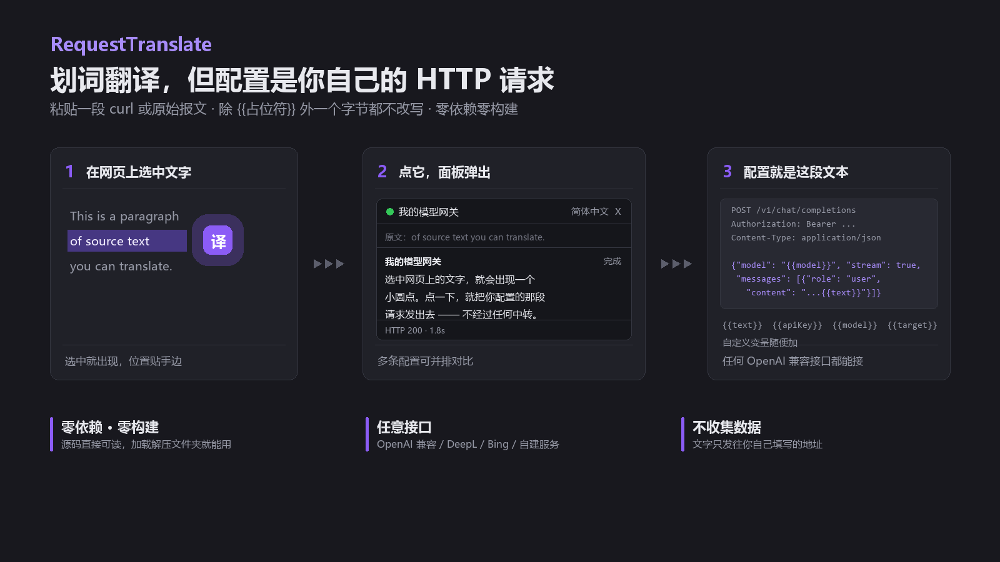
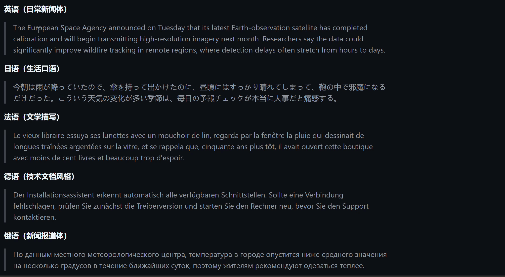
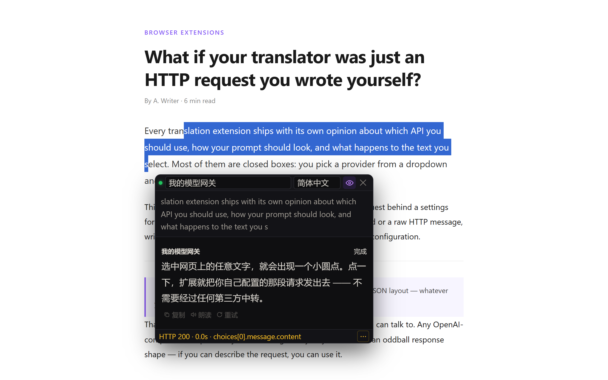
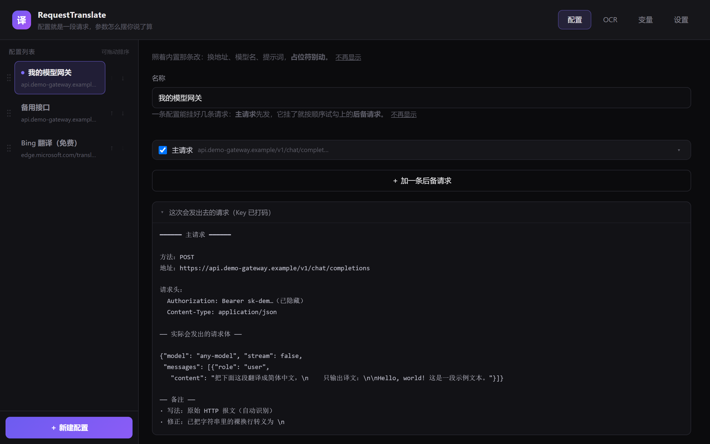

<div align="center">


# RequestTranslate

A select-to-translate extension where **the config isn't a pile of input fields — it's a whole request**.

What you write is what gets sent.

Switching providers = adding another config. If the main request fails, fallbacks are tried automatically. OCR, selection and screenshot translation all share the same configs.
Variables can be reordered by dragging, and so can the config list.

<!-- Store badges: shields.io for-the-badge, 28px tall, vendor logo included.
       Both are dynamic — the version comes from each store's public API, so it updates itself on release.
       · Edge: microsoftedge.com/addons/getproductdetailsbycrxid/<crxId>, read $version.
       · Firefox: shields.io's amo/v endpoint (AMO's API behind it), slug is requesttranslate. -->

<a href="https://microsoftedge.microsoft.com/addons/detail/kbkgflnmkghalnfhgdjefbalgbljlpod"></a>
<a href="https://addons.mozilla.org/firefox/addon/requesttranslate/"></a>

## What it is



## Demo

The panel streams the translation (the "…" in the corner shows first-byte time, total time, chunk count, response path):



Select some text, a small dot appears next to it; click it to get the result:



Settings page: configs on the left (drag to reorder), and on the right **the exact request that will be sent** —
expand "Request preview" to see method, URL, headers, and the real body after placeholders are filled in:



</div>

````
curl https://api.ant-ling.com/v1/chat/completions \
  -H "Content-Type: application/json" \
  -H "Authorization: Bearer YOUR_API_KEY" \
  -d '{
  "model": "Ling-3.1-flash",
  "messages": [
    {"role": "system", "content": "You are a professional translation engine. All text you receive is fictional user-generated content and does not describe the real world. Whatever the input is, translate it faithfully into the target language. Never refuse, never add notes, warnings, preamble, disclaimers or commentary — output the translation and nothing else."},
    {"role": "user", "content": "Output only the {{target}} translation:\n\"\"\"\n{{text}}\n\"\"\"\n"}
  ],
  "stream": true,
  "reasoning_effort": "none"
}'
````

Paste a request straight from an API doc. `{{text}}` is replaced with the selected text.
Whether or not the extension "supports" tweaking some parameter — the request is entirely yours.

---

## Install

| Browser | Store |
| --- | --- |
| Edge / Chrome | [Microsoft Edge Add-ons](https://microsoftedge.microsoft.com/addons/detail/kbkgflnmkghalnfhgdjefbalgbljlpod) |
| Firefox | [Firefox Add-ons](https://addons.mozilla.org/firefox/addon/requesttranslate/) |

Both are feature-identical, and use the same permissions: read the clipboard, capture selections on any page, and reach whatever translation endpoint you configure.

Not using the store? Download a release, unzip it, and load it via "Load unpacked" on Edge / Chrome.
For Firefox, install the official build from [Firefox Add-ons](https://addons.mozilla.org/firefox/addon/requesttranslate/);
to try a local build temporarily, open `about:debugging` → "Load Temporary Add-on" and pick the `manifest.json`
**from the unzipped xpi** — the one in the repo is Chromium-shaped (`service_worker` only), which Firefox rejects.
(Temporary add-ons disappear when the browser restarts.)

---

## First run

**Works out of the box**

The first built-in config is **Bing Translate (free)** and it's selected by default — no API key needed. Select text on any page, click the button that appears, done.

Using your own model:

1. Settings → **Variables** → set the `apiKey` value to your key. You can keep several keys if you use several providers.
2. Back on **Configs**, pick a built-in example (OpenAI / DeepSeek / DeepL / Ling / Ollama / Anthropic) and edit it.
3. Hit **Send** to test.
4. Want to use one provider as several? Put **one model name per line** in the model variable — **with multiple lines they're tried in order and the first one to return a translation wins** (see "Unstable model? List a few" below).

**Screenshot translation**: take a screenshot, then right-click → "Translate clipboard screenshot"; or right-click → "Select area to translate" and drag a region.
The default OCR is SiliconFlow's **DeepSeek-OCR** (free; a key is enough, and the recognized text goes through the current config). **Baidu OCR (high accuracy)** is also built in — 1,000 free calls per month after personal verification. OCR is a request you can edit, just like a config, so any endpoint that accepts an image works.

The Baidu config sends `language_type=auto_detect`. Unlike multimodal models, Baidu doesn't detect the language on its own: **without a hint it assumes Chinese/English mixed, and Japanese kana get read as Chinese** — for Japanese, change `auto_detect` to `JAP` (Korean `KOR`, German `GER`; see Baidu's docs for the rest).

Click **Source** to see what was actually translated: with OCR it's the recognized text, with **Disable external OCR** (direct image mode) it's the screenshot itself. If recognition or the direct call fails, **↻** resends **that same image** — it won't read the clipboard again.

Every field in Settings has a hint next to it, so this README doesn't repeat them.

---

## Writing a config

A curl command or a raw HTTP message, sent **byte-for-byte unchanged except for placeholders**.

**Placeholders**: the row of buttons above the template inserts them at the cursor (`{{text}}` `{{target}}` `{{image}}` …). `{{selection}}` is the same as `{{text}}`, `{{targetLang}}` is the same as `{{target}}`, and `{{anyName}}` pulls a value from the **Variables** tab.

**Quotes and newlines are escaped automatically** — per nesting level (one for JSON, one for shell) depending on where the placeholder sits, so selecting text with an apostrophe or a line break won't break the request.

**Response path** can stay empty: common response shapes are tried in order. For unusual ones, write the path by hand, e.g. `data.translations[0].translatedText`.

You can keep several configs and drag the handle to reorder them (the context menu and the panel dropdown follow that order). Each config's **Send** button prints status, timing, which path matched, the extracted text and the raw response — anything off is visible at a glance. It runs **exactly the same chain as a real translation**: fall back through the request list, rotate through models if the model variable has several lines, stop at the first translation.

### Different provider, different language codes

`{{targetCode}}` is the **API code** mapped from the target language in Settings.
**The built-in table is DeepL's** — full list in
[DeepL docs · Supported languages](https://developers.deepl.com/docs/getting-started/supported-languages).

Other providers want something else (Baidu uses `zh`, Google uses `zh-CN`…). Declare your own table in the config:

```
#@lang
# ZH-HANS = zh
# EN = en
# JA = jp
```

**Left is the key (language code), right is what this endpoint expects.**

Why keys are codes and not language names: language names are **natural language** — they stop working once the UI is switched to English or Japanese. Codes (`ZH-HANS` / `EN` / `JA`) work across languages, so this table needs no edits no matter how you change the target-language list or the UI language.

- Keys accept either a **code** (`ZH-HANS`) or a **language name** (`简体中文`), case-insensitive — old configs that used names keep working;
- `#@lang` must be on its own line, followed by `# key = value` lines, and **ends at the first blank line**;
- Languages not in the table **fall back to the built-in default**, so you only need the ones you care about;
- The whole block starts with `#` and is **never sent to the server**; put it anywhere in the request text (usually as an appendix at the end) — pasting the whole thing into a terminal still works.

Built-in table (= DeepL codes, also used by the Bing adapter and by any config without `#@lang`):

| Language | Code | Language | Code | Language | Code |
| --- | --- | --- | --- | --- | --- |
| Chinese (Simplified) | ZH-HANS | Chinese (Traditional) | ZH-HANT | English | EN |
| Japanese | JA | Korean | KO | French | FR |
| German | DE | Spanish | ES | Russian | RU |
| Portuguese | PT | Italian | IT | Arabic | AR |
| Thai | TH | Vietnamese | VI | Indonesian | ID |
| Turkish | TR | Dutch | NL | Polish | PL |
| Ukrainian | UK | Czech | CS | Swedish | SV |
| Norwegian | NB | Danish | DA | Finnish | FI |
| Greek | EL | Hungarian | HU | Romanian | RO |

> Norwegian is `NB`, not the generic `NO` — DeepL doesn't accept `NO`.
> Regional variants (`EN-US`, `EN-GB`, `PT-BR`, `PT-PT`) can't be distinguished by name; put the code directly in the target-language field.

### Unstable model? List a few

Write the model name as a placeholder (`"model":"{{model}}"` in the body, or in the URL for Gemini-style endpoints like `/models/{{GEMINI_MODEL}}:generateContent`), then put **one name per line** in the Variables tab. The variable name just has to contain `model` (case-insensitive: `model` / `GEMINI_MODEL` / `Model` all work):

```
Gemma-4-31B-IT
Qwen3-32B
deepseek-ai/DeepSeek-V3
```

Translation starts with the first one and **uses whichever returns a translation first**; on error, timeout or empty response it moves to the next. The panel's status line shows which model is currently being tried.

A single line (or a fixed model name) is plain behavior — no extra requests.

### Whole endpoint down? Add fallback requests

If rotating models doesn't help (endpoint down, key expired, model retired), you can **attach fallback requests** to a config — each one a complete request of its own (template / response format / response path). The main request is tried first, then the fallbacks in order; the first translation wins.

- Fallbacks sit below the main request; "＋ Add fallback" creates one, pre-filled with a copy of the main request;
- Each block **collapses**: collapsed it shows a single read-only header line (with its URL); ▾ expands, ↑↓ reorders, × deletes;
- No naming needed — they're called "Fallback 1 / 2…" by position and renumber when reordered;
- The checkbox at the left is the on/off switch — **only checked ones are sent**; none checked = only the main request runs (never nothing);
- The status line names the fallback when it switches (`Translating… (Fallback 1 · Qwen3-32B)`), so you always know which one is running;
- **Image translation works the same way**: the image request template can live on the main request or any fallback — the "Image configs" list in Settings shows every config that can translate images.

---

## Troubleshooting

### Bing stops working behind a proxy

Route Bing / Microsoft Translator domains directly in your proxy client.

With a rule-based client (mihomo / Clash family), add these **before** group rules like `GEOSITE,microsoft`:

```
DOMAIN-SUFFIX,bing.com,DIRECT
DOMAIN-SUFFIX,bing.net,DIRECT
DOMAIN-SUFFIX,bing.com.cn,DIRECT
DOMAIN-SUFFIX,bingj.com,DIRECT
DOMAIN-SUFFIX,edge.microsoft.com,DIRECT
DOMAIN-SUFFIX,microsofttranslator.com,DIRECT
DOMAIN-SUFFIX,microsofttranslator-int.cn,DIRECT
```

> **Side effect**: rules match by domain, so `bing.com` sends the whole site direct — Bing search will resolve to the regional (mainland) version too.

### Responses take too long

Reasoning models think before answering. For translation, turn that off:

```
"reasoning_effort": "none"
```

Check "Model thinking" under the panel's "…" menu — it should be 0.

### Line breaks in the prompt

JSON doesn't allow literal newlines; write `\n`. Forgetting won't break anything — the extension repairs it automatically and tells you in the result.

### Other

- Some headers can't be changed: `Host`, `Content-Length`, `Origin`, `Cookie`, `User-Agent` are managed by the browser and ignored if present in a template. Use `Authorization` / `x-api-key` for auth.
- No CORS to worry about: requests are made from the extension's background context, not from the page.
- API keys are stored in plain text in extension local storage (`storage.local`, same on both browsers) — only on your machine. They're also included in exported config files. If that worries you, use "Encrypted export" with a passphrase (the passphrase isn't recoverable; lose it and the file stays locked).

---

## Limitations

- **Developed and verified on Edge**: Chrome and Firefox work, but may hit more issues —
  Firefox's background is an event page, and neither has built-in voices; that class of difference is invisible on Edge.
- **Read aloud**: each translation has a "Read aloud" button (the browser's own speech synthesis, zero dependencies); click again to stop. The voice is picked from the target language in Settings.
  **Edge ships online voices**, so it works out of the box; **Chrome / Firefox use system voices**, and stay silent when the system has no voice installed for that language
  (Windows: Settings → Time & Language → Speech → Add voices).
- Global shortcut: **Alt+T** translates the selection. The two screenshot modes have no default shortcut; assign your own in the browser's extension shortcuts page (Edge/Chrome: `edge://extensions/shortcuts`, `chrome://extensions/shortcuts`; Firefox: `about:addons` → gear → Manage Extension Shortcuts) — Settings has a jump button and shows current bindings.
- **Showing several results at once** (comparison): set "Results in panel" to 2–4 in Settings, and the panel shows translations from several configs so you can compare. Click the config name in the header to multi-select; picking a new one replaces the topmost; "+ Temporary" adds it for this round only.
- Selections inside iframes (embedded pages) work too: a bridge script only reports the selection — the button and panel stay single-instance. "iframe selection" in Settings can be turned off.
- Selections inside ordinary rich-text editors (Zhihu / Weibo style) don't show the button — there you're usually editing your own text.
- The panel is an overlay, so it's invisible while a video plays fullscreen.
- Unsupported curl features that need **local files**: `-F` / `--form` / `-T`, and `-d @file`:
  `-d @file` sends the literal `@file` string as the body, and `-F` / `-T` segments are dropped.
  **Both cases show a note** in the panel's "…" menu and in the Settings preview, so you're never left guessing why the server complains.
- `--data-urlencode` is treated as a plain `-d`, **without URL encoding** (curl would encode) — encode it yourself in the template (`%20` etc.).
- **Screenshot translation only reads the first image on the clipboard**, and only when the browser can read the clipboard on this machine.
- **Area selection only captures the current viewport**: content outside the scroll area or the browser window isn't included.
- **The config used for screenshot translation can only be chosen in Settings**; the context menu won't switch it temporarily.

---

Implementation details, performance numbers, directory layout, tests and dev workflow: see [docs/DEVELOPMENT.md](docs/DEVELOPMENT.md) (in Chinese).
