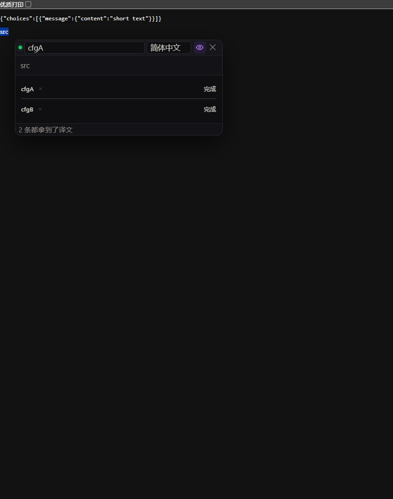

# 面板样式：悬停展开（只加展开，别的不动）

> **默认长什么样，这份就是长什么样。** 唯一的区别：译文和三个按钮默认收起，
> 鼠标悬停在那一条上时展开。没有卡片、边框、彩色文字、装饰竖条 —— 一概不加。



## 怎么用

设置页 →「面板」→「自定义面板样式（CSS）」→ 整段粘进去。

## 和默认相比，只改了这四处

| 元素 | 默认 | 这份 |
| --- | --- | --- |
| `.rt-slot-b`（译文） | 正常显示 | `height: 0`，悬停时 `height: auto` |
| `.rt-acts`（三个按钮） | 正常显示 | `height: 0; opacity: 0`，悬停时展开 |
| `.rt-acts` 的 `margin-top` | `.25em` | 收起时 `0`，展开时 `.25em`（保持原值） |
| `.rt-slot-b` / `.rt-acts` | 无过渡 | 加 `height` 过渡 |

其余全都沿用默认值：面板底色、圆角、边框、块头字号与颜色、配置名颜色与字重、
译文字号与颜色、按钮的颜色 / 字号 / padding / 圆角 —— **一处都没覆盖**。

实测对比（默认 vs 这份，逐项读取计算样式）：

```
同   panel    底色 / 圆角 / 边框
同   slot     padding / 边框 / 圆角 / 底色
同   header   字号 / 颜色 / padding / margin / 底色
同   name     颜色 / 字重
同   body     颜色 / 字号 / padding / margin
同   act      三个按钮的颜色 / 字号 / padding / 圆角
不同 acts     仅 opacity（收起 0 / 展开 .55）与 margin-top
```

高度：**默认 105px → 收起 39px → 悬停 105px**（悬停时和默认一模一样）。

## 完整源码

```css
/* ═══════════════════════════════════════════════════════════════
   悬停展开：其余一切保持默认，只把「译文 + 三个按钮」藏起来，
   鼠标悬停在这一条上时展开。
   ═══════════════════════════════════════════════════════════════ */

/* height:auto 要能参与过渡，靠这一句（Edge / Chrome 129+）。
   老浏览器不支持时降级成瞬开，不会坏。 */
#rt-panel { interpolate-size: allow-keywords; }

/* 译文：默认收起 */
#rt-panel .rt-slot-b {
  height: 0;
  overflow: hidden;
}

/* 悬停在**这一条**（.rt-slot）上时展开 —— 不是只挂在块头。
   只挂块头的话，鼠标往按钮移就会离开块头、当场收起，按钮点不到。 */
#rt-panel .rt-slot:hover .rt-slot-b,
#rt-panel .rt-slot:focus-within .rt-slot-b {
  height: auto;
}

/* 三个按钮同样收起 / 展开。display:flex 是它们原本就有的，别覆盖掉 */
#rt-panel .rt-acts {
  height: 0;
  overflow: hidden;
  opacity: 0;
  margin-top: 0;
}
#rt-panel .rt-slot:hover .rt-acts,
#rt-panel .rt-slot:focus-within .rt-acts {
  height: auto;
  opacity: .55;   /* 默认就是 .55，别改 */
  margin-top: .25em;
}

/* 淡入淡出 + 非线性缓动（只影响观感，不改任何尺寸 / 颜色 / 布局） */
#rt-panel .rt-slot-b,
#rt-panel .rt-acts {
  transition: height .32s cubic-bezier(.2, .9, .3, 1), opacity .2s ease, margin-top .32s cubic-bezier(.2, .9, .3, 1);
}

/* 块头做成可以悬停的「标题条」：只加一条很淡的悬停底色，尺寸和字号一概不动 */
#rt-panel .rt-slot-h {
  cursor: default;
}

/* 无障碍：不做缓动 */
@media (prefers-reduced-motion: reduce) {
  #rt-panel .rt-slot-b,
  #rt-panel .rt-acts { transition-duration: .01ms !important; }
}
```

## 两个必须知道的点

### 一、必须让 `height` 参与动画，不能用 `max-height`

`max-height: 0 → 一个很大的值` 看着像能过渡，其实**动画看不见**。逐帧实测：

```
t=12ms   max-height=88px    内容已全露（译文真实只占 34px）
t=195ms  max-height=669px   到终态，但视觉上 400ms 前就不动了
```

`max-height` 只是上限，动画一开头就冲过真实内容高度，之后全程空转。
`grid-template-rows: 0fr → 1fr` 也不行（实测只有 4 个中间高度值）。

唯一可行的是 `height: 0 ↔ auto` + `interpolate-size: allow-keywords`
（Edge / Chrome **129+**）。实测 37 个不同高度值，逐帧均匀。
老浏览器降级成瞬开，不会坏。

### 二、悬停判定挂 `.rt-slot`，不能只挂块头

只让「配置名」触发展开的话会死锁：

```
鼠标移到配置名 → 展开
鼠标往按钮移动 → 离开配置名 → 收起
按钮还没点到就没了
```

所以作用范围必须包含展开后的内容。副作用是**鼠标停在译文上也不收起**，正好方便阅读。

## 如果连按钮也不想藏

把 `.rt-acts` 那两条规则删掉，只留 `.rt-slot-b` 的展开 —— 按钮就一直显示。

```css
#rt-panel .rt-slot-b { height: 0; overflow: hidden; }
#rt-panel .rt-slot:hover .rt-slot-b { height: auto; }
```

## 已知取舍

- 收起态看不到译文。多条对比时面板会矮很多；但若想一眼扫完所有译文，这个样式不合适。
- 想「移开延迟几秒再收」纯 CSS 做不到（`:hover` 一离开就触发）。近似做法是把收起那半边的
  `transition-duration` 拉长（比如 `1.2s`），看起来像"慢慢合上"。

---

其他样例：`CUSTOM-PANEL-DEMO.md`（能力上限）。钩子清单见 `DEVELOPMENT.md`。
